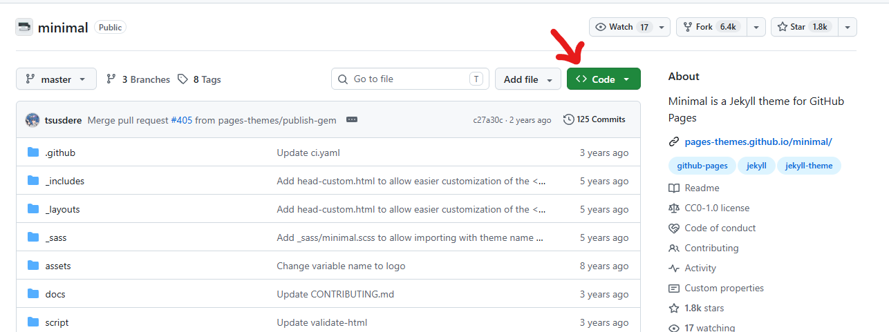
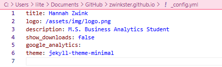

# Projects
## Sections
- [Creating This E-Portfolio](#creating-this-e-portfolio)

## Creating This E-Portfolio
### Introduction
This project was designed to teach us the process of creating a professional, customizable website while also being a place to showcase our knowledge, skills, and accomplishments. For this e-portfolio we used GitHub Pages to host the website and the `minimal` theme created by *OrderedList* as the foundation for its design.
### Step 1: Setting Up the Website
To complete this portfolio you first have to open a new repository on GitHub.com. To ensure that you created a static site within GitHub pages, use the formatting of `<your_username>.github.io` in the repository name and change the license to MIT if it fits. This sets up the repository, or place to store your files needed to host your website. 
### Step 2: Setting a Theme
Click [here](https://github.com/pages-themes/minimal) to download the `minimal` theme, then follow along to add it to your website.
1. While viewing the `minimal` theme repository, click the green **Code** dropdown.

2. Click <u>Download ZIP</u>.
3. Find your repository folder on your computer, if you haven't cloned it you can follow these steps [here](https://docs.github.com/en/repositories/creating-and-managing-repositories/cloning-a-repository).
4. Extract the `minimal` theme folder into your repository folder.
5. Finally, make a commit by using the command `git push` in your computers command prompt. Instructions can be found [here](https://docs.github.com/en/get-started/using-git/pushing-commits-to-a-remote-repository).

### Step 3: Editing a Markdown File
In your repository you'll find an `index.md` Markdown file that is the basis of your website. Make whatever edits you want to the file using any application that can edit Markdown, like VSCode. You can use the [markdown guide](https://www.markdownguide.org/cheat-sheet/) for help with formatting. There is also a `README.md` file in your repository you can edit for GitHub even if it does not appear on your website. If you commit any changes, make sure to wait a few minutes before checking your website for the updates.
### Step 4: Final Touches
There are a few things you can change to make this website more your own. To add a picture to your front page all you need to do is rename your image file to logo.png. Once you have the file named, drag it into the assets folder of your repository, then replace the image in the img file. This will insert the picture top left of your main page. If you want to add pictures into your Markdown, you can use this forum [here](https://stackoverflow.com/questions/41604263/how-do-i-display-a-local-image-in-markdown).
To edit the configuration of the minimal theme you can edit the `_config.yml` file.

In this file you can edit everything displayed on your website that is not contained within the Markdown. Here you will change your title and description, and decide whether to keep a download link for your repository on your website by making `show_downloads:` true or false. 
You can also add multiple pages to your website using subpages. To create a subpage make a new file in your repository folder. Within that file you can insert a Markdown with a title pertaining to your subpage. To insert that subpage on your website, add a code like this: `[Click Here](subpage_folder/Markdown_Name.md#Header_in_New_Markdown)` to your `index.md`.

### References

| Resource | Reference |
| --- | --- |
| [Creating Subpages](https://stackoverflow.com/questions/2822089/how-to-link-to-part-of-the-same-document-in-markdown) | “How to Link to Part of the Same Document in Markdown.” *Stack Overflow*, https://stackoverflow.com/questions/2822089/how-to-link-to-part-of-the-same-document-in-markdown. Accessed 30 Oct. 2026. |
| [Markdown Guide](https://www.markdownguide.org/cheat-sheet/) | “Markdown Cheat Sheet.” *Markdown Guide*, https://www.markdownguide.org/cheat-sheet/. Accessed 30 Oct. 2026. |
| [Commit to Repository](https://docs.github.com/en/get-started/using-git/pushing-commits-to-a-remote-repository) | “Pushing Commits to a Remote Repository.” *GitHub Docs*, GitHub, https://docs.github.com/en/get-started/using-git/pushing-commits-to-a-remote-repository. Accessed 30 Oct. 2026. |
| [Minimal Theme](https://github.com/pages-themes/minimal) | “Minimal.” *GitHub*, GitHub, https://github.com/pages-themes/minimal. Accessed 30 Oct. 2026. |
| [Cloning Repository](https://docs.github.com/en/repositories/creating-and-managing-repositories/cloning-a-repository) | “Cloning a Repository.” *GitHub Docs*, GitHub, https://docs.github.com/en/repositories/creating-and-managing-repositories/cloning-a-repository. Accessed 30 Oct. 2026. |
| [Display Image in Markdown](https://stackoverflow.com/questions/41604263/how-do-i-display-a-local-image-in-markdown) | “How Do I Display a Local Image in Markdown?” *Stack Overflow*, https://stackoverflow.com/questions/41604263/how-do-i-display-a-local-image-in-markdown. Accessed 30 Oct. 2026. |
